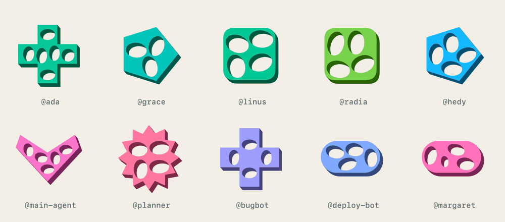
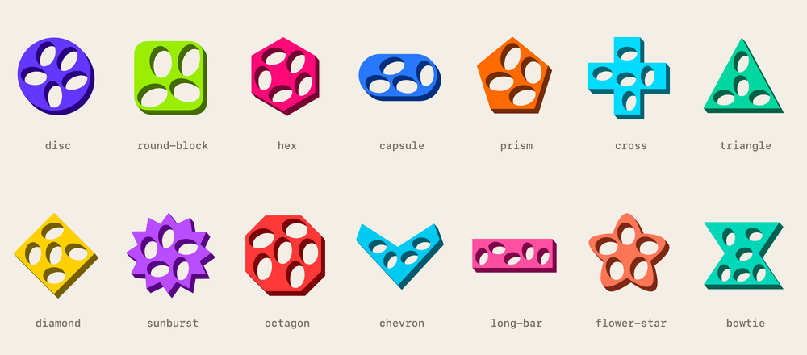
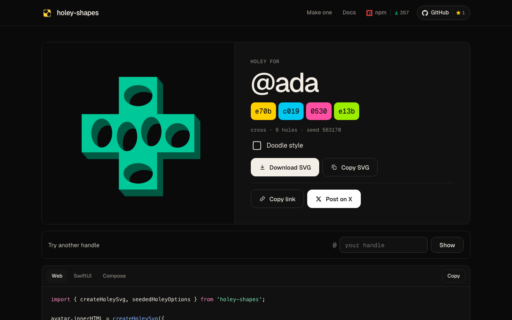
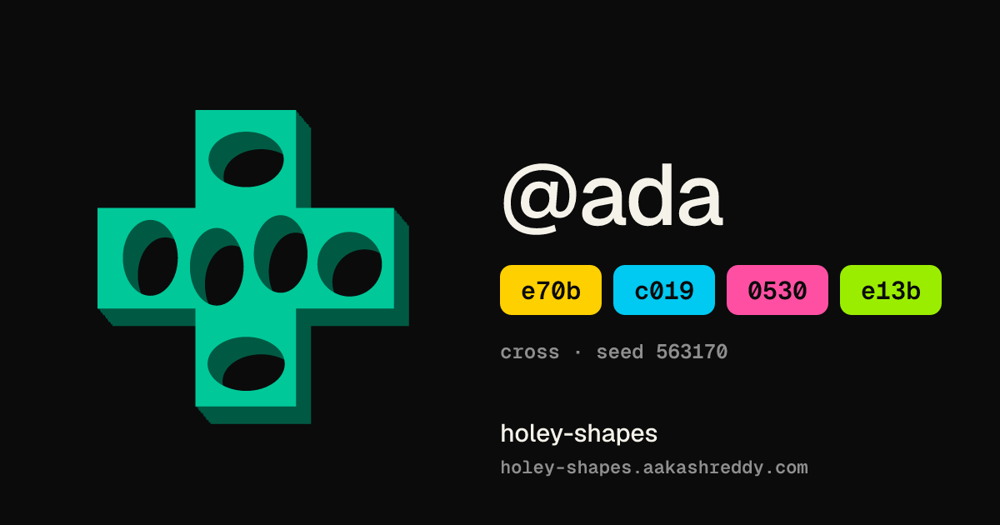

<div align="center">

# holey-shapes

**Avatars with holes.** Type any name and get a colorful, one-of-a-kind shape. The same name always gives the same shape.

[](https://www.npmjs.com/package/holey-shapes)
[](https://www.npmjs.com/package/holey-shapes)
[](https://github.com/skyaara/holey-shapes/actions/workflows/ci.yml)
[](LICENSE)

[**Try it on the website →**](https://holey-shapes.aakashreddy.com)



</div>

## What is it?

holey-shapes turns a name, user ID or email into an avatar. Each one is a chunky 3D shape with holes punched in it. The holes close and reopen when you hover.

- **Same name, same holey.** It works on any device and in any language, with nothing stored.
- **Web, iPhone and Android.** All three draw exactly the same holey.
- **No dependencies.** It's one small package and the output is a plain SVG.
- **Lots of variety.** It mixes 14 shapes, 3,600 colors, hole layouts, turns and flips.

## Quick start

```sh
npm install holey-shapes
```

```js
import { createHoleySvg, seededHoleyOptions } from 'holey-shapes';

avatar.innerHTML = createHoleySvg(seededHoleyOptions('ada'));
```

That's it: `@ada` now has the green cross from the top of this page, everywhere.

<details>
<summary><b>SwiftUI</b></summary>

In Xcode, choose **File → Add Package Dependencies** and add `https://github.com/skyaara/holey-shapes`.

```swift
import HoleyShapes

HoleyShapeView(configuration: .seeded("ada"))
    .frame(width: 64, height: 64)
```

</details>

<details>
<summary><b>Jetpack Compose</b></summary>

Add `maven("https://jitpack.io")` to your repositories, then:

```kotlin
implementation("com.github.skyaara:holey-shapes:v2.1.0")
```

```kotlin
HoleyShapeView(
    config = HoleyShapeConfig.seeded("ada"),
    modifier = Modifier.size(64.dp),
    contentDescription = null,
)
```

</details>

## Two styles

Holeys are solid by default. Pass `doodle: true` for a hand-drawn look (web only for now).

<p align="center"></p>

```js
createHoleySvg({ ...seededHoleyOptions('ada'), doodle: true });
```

## Or pick your own

Skip the names and choose the shape, color and number of holes yourself:

```js
createHoleySvg({ shape: 'flower-star', color: '#FF7A59', holes: 5 });
```

<p align="center"></p>

## Bring your own hash

Already have a hash or a database ID? Use any whole number to pick the shape and layout, and you get a plain SVG string back:

```js
import { createHoleySvg, shapeNames } from 'holey-shapes';

const h = myHash(user.id);
const svg = createHoleySvg({
  shape: shapeNames[h % shapeNames.length].key,
  holes: 3 + (h % 4),
  seed: h % 1_000_001,
});
```

It runs anywhere JavaScript does, including Node, server rendering and edge workers, because it needs no browser.

## Share links

Every name has its own page, like [holey-shapes.aakashreddy.com/@ada](https://holey-shapes.aakashreddy.com/@ada). You can download or copy the SVG there. Post the link on X and the preview shows that holey.

<p align="center">
  
  
</p>

## Learn more

- [**Reference**](docs/REFERENCE.md): every option, the platform details, and how seeding and packing work
- [**Contributing**](CONTRIBUTING.md): how to set up and run the checks; issues and PRs are welcome
- [**Changelog**](CHANGELOG.md) · [**Security**](SECURITY.md) · [**Code of conduct**](CODE_OF_CONDUCT.md)

MIT licensed. Made by [@skyaara](https://github.com/skyaara).
